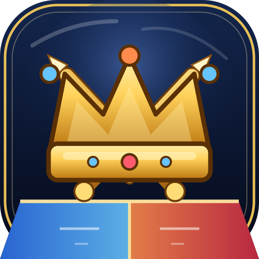

<div align="center">



# 皇室战争 · Toy Diorama

程序化低模 Q 版皇室战争同人项目 · Godot 4.7.2

[网页版](https://3844775306-code.github.io/ClashRoyale/) · [Releases（Windows / Android）](https://github.com/3844775306-code/ClashRoyale/releases)

</div>

## 项目特色

- **玩具沙盘低模 + Q 版**：全部模型程序化生成，不使用外部 GLB。
- **完整对战**：卡组、圣水、公主塔/国王塔、法术、召唤、AI。
- **局域网联机**：
  - 1V1 / 2V2 / 1V2；
  - 红蓝席位房间，空席 AI 托管；
  - 房主权威服务器，ENet UDP（端口 `24500`）；
  - 入场同步、倒计时、双端结算、表情、回放。
- **回放**：单机与联机对局均可在设置中开启录制。
- **新手训练营**：奖杯为 0 的新玩家自动进入；其他玩家可从主菜单底部「新手教程」进入。理论含目标类型教学，实战按肉盾→亡灵反制骑士→法术清场→摧毁公主塔推进；敌方 AI 会随机放牌，完成后播放结算面板并奖励 1 个宝箱。
- **初始卡牌**：新手的固定六张为弓箭手、万箭齐发、骑士、亡灵、巨人、火球，默认出战卡组也是这六张；其他卡牌仍由皇室征程/宝箱解锁。
- **表情图标**：使用 Twemoji 原版表情图（CC-BY 4.0），程序化彩色圆牌承载，不依赖系统 emoji 字体。
- **部落搜索**：进入搜索页自动显示已有部落，搜索框/按钮只做筛选。
- **AI 卡池**：常规 AI 只使用新手六卡 + 当前竞技场已解锁卡牌。
- **头像**：每位玩家随机生成 Q 版头像；设置里可上传图片或随机换头像，头像显示在部落、排行榜、联机席位和顶栏。
- **部落聊天**：头像左置的现代聊天气泡、时间、卡牌图片请求/捐赠，避免头像遮挡消息；搜索页默认显示已有部落。
- **宝箱反馈**：升级后的 3D 宝箱（拱形盖/木板/铆钉/锁扣/把手）会在结算返回主菜单时飞入宝箱按钮，按钮显示未开数量；皇室征程宝箱也使用同款 3D 模型。
- **多端**：Windows EXE、Android APK、Web（无多线程，适配 GitHub Pages；Web 端 emoji 自动替换为中文标签，避免方框乱码）。

## 下载

| 平台 | 文件 |
|---|---|
| Windows | `ClashRoyale-Net11-WebRTC-Windows.zip`（Releases） |
| Android | `ClashRoyale-Net.apk`（Releases） |
| Web | [GitHub Pages](https://3844775306-code.github.io/ClashRoyale/) / `ClashRoyale-Web.zip` |

## 操作

- 点击卡牌后再点战场，或直接拖拽卡牌到战场。
- 联机：同一 WiFi 可用局域网房间；不同网络使用「跨网创建」生成 6 位房间码，朋友「跨网加入」后进驻席位。
- 房主可给红蓝双方增加席位（最多每方 2 席）；所有真人入驻后才能开始。

## 本地构建

需要 Godot **4.7.2 stable** 与对应导出模板。

```powershell
# 网页
godot --headless --path . --export-release "Web" "build/web/index.html"

# Windows
godot --headless --path . --export-release "Windows Desktop" "ClashRoyale-Net11.exe"
```

Android 导出后再用 `apksigner` 签名；签名文件不随仓库提供。

## 卡牌数据

- 运行时读取 `data/units_level11_utf8.csv` 或 `data/units_level11.csv`，按修改时间选择较新的表。
- 卡组/详情/升级与战斗共用 `BattleManager.load_card_configs()`。
- 详细说明见 [`docs/卡牌数据表说明.md`](docs/卡牌数据表说明.md)。

## 说明

- 本项目为非商业同人项目，与 Supercell 无关联；Clash Royale 相关名称与设定归 Supercell 所有。
- 公开仓库不包含 Android 签名文件、AI 训练产物、本地测试日志与构建缓存。

- **收藏等级奖励**：20 级起每 10 级一个奖励，每张卡升级 +1 收藏等级；收藏/卡牌升级页可查看和领取。

- **商店每日免费**：卡牌栏每天随机 1 件原价低于 2000 金币的商品免费。
- **红点提示**：主菜单商店/宝箱/收藏/皇室征程按钮显示待领取数量；商店免费、收藏里程碑、宝箱、征程奖励有可领取内容时显示红点。

- **卡牌大师**：使用卡牌累计 10/50/150 次，领取三档大师奖励；入口在「收藏」或「卡牌升级」页。

- **主题赛季**：每月轮换主题与指定主题卡牌，奖励间隔穿插金币、宝石、万能卡、宝箱、表情；50 档，每 10 皇冠一档；主菜单部落后方有进度条和红点。

- **宝箱**：每稀有度最多 1 种卡；宝箱列表顶部使用 3D 宝箱。

- **部落捐赠**：普通卡固定请求 40、稀有/史诗固定 4；传奇不可请求；史诗仅周日可捐赠；请求气泡显示卡图、捐赠进度和已捐/自己不可捐按钮。
- **周日商店**：免费卡固定为价值 5000 金币的史诗卡。

- **账号存档隔离**：每个邮箱账号独立存档目录，切换新账号不会继承旧账号的卡牌/部落/征程数据；部落与排行榜使用账号派生 ID。
- **聊天日期**：部落聊天消息显示月日与时间；请求气泡显示卡图与捐赠进度，捐赠按钮会区分自己/已捐/已完成/周日限制。

- **回放**：按账号独立存储，最多保留 20 条非永久录像；可在列表设置“永久保存”，永久录像不计入上限。
- **部落刷新**：进入前加载云端数据；界面每 3 秒轮询聊天/成员/捐赠进度，创建/加入/请求/捐赠后立即刷新。

- **赠卡到账**：捐赠进度写入部落数据，接收方进入/刷新部落时领取待收卡牌；捐赠者库存同步云端。
- **个人简介**：点击部落成员或聊天头像打开资料弹窗。

- **邮箱**：版本更新、官方福利、部落赠卡；赠卡需手动领取，领取时显示动画；主菜单邮箱红点。
- **赠送动画**：收到赠卡时部落界面弹出提示并显示捐赠者，邮件中保留来源。

- **官方图片**：请求卡牌/奖励卡图优先使用 `assets/official_cards` 官方卡面，未覆盖卡牌回退原资源。
- **全局邮件**：编辑并推送 `data/global_mail.json` 即可让所有客户端在下次启动/打开邮箱时收到官方通知。

- **统一领取动画**：皇室征程、邮箱、卡牌大师、收藏等级、主题赛季、商店免费领取共用同一套领取成功动画。

- **商店卡池**：只出售当前竞技场已解锁卡牌；最低总价随竞技场提高（300+竞技场×100）。

- **商店竞技场过滤**：仅使用皇室征程解锁卡牌，避免新卡误标 1 阶；最低总价 300+竞技场×100。
- **邮件换行**：显示时兼容旧存档中的字面量 `\n`，统一转为真实换行。

- **商店**：只出当前竞技场皇室征程已解锁卡牌，最低总价 300+竞技场×100。
- **好友**：请求界面统一深色金边卡片；同意后对方邮箱收到通知；个人资料增加最高奖杯/竞技场/捐赠/加入时间。

- **头像全局可点**：顶栏、部落、排行榜、好友中心、联机席位头像均可打开个人资料。
- **排行榜自动刷新**：每 5 秒刷新并保持滚动位置。
